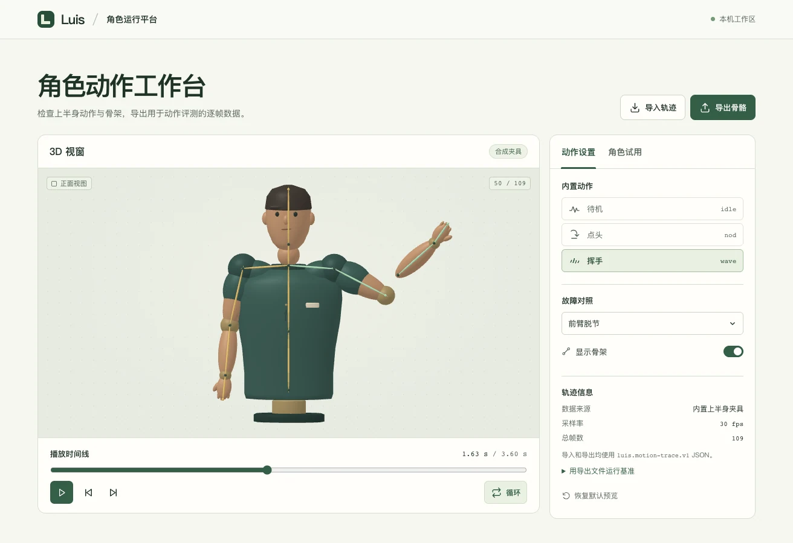
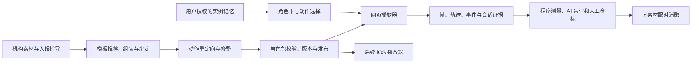

# Luis

[在手机上打开蓝发角色小窗](https://doyoulikelin-wq.github.io/Luis/platform/web/window/) · 支持点按、长按、长按拖拽和滑动。按住黑窗后左右拖动，中途折回可观察视线和头部的跟随差异。

Luis 是一个面向上半身虚拟角色的制作与运行项目。仓库分为两部分：**benchmark** 定义如何判断一个角色可交付、如何比较模型和工作流；**platform** 在网页播放角色与动作，能导出相同输入供独立复核。iOS 是后续运行端。

| 部分 | 已经可以做什么 | 入口 |
| --- | --- | --- |
| Benchmark 构建 | 26 项通用角色检查、18 项动作专项检查、审核员校准、单变量及 2×2 对照。用带时间戳的三维轨迹检查骨段伸长、连接间隙、肘部屈曲、速度与采样。 | [通用题库与用法](benchmark/README.md) · [动作专项](benchmark/motion-review.md) · [全流程消融计划](benchmark/experiments/README.md) |
| 运行平台 | 浏览器内置一个三维诊断角色。待机、点头、挥手可暂停、打断、逐帧回放和叠加骨架，可重现拉长、脱节和抖动。角色试用支持名称、配色、两种回应风格、独立本机称呼记忆和公开角色包导入导出。 | [网页与启动方式](platform/README.md) · [角色包协议](platform/contracts/character-package.schema.json) · [示例动作轨迹](platform/demo/nod.luis.json) |



*网页实录：同一动作切到「前臂脱节」并暂停，可以对照骨段末端与前臂起点。*

## 开发路径探讨

[三条角色动画路线对照](development-paths/README.md)比较外接 Tripo 制模与实时骨骼、共享首尾姿态的视频、序列帧与图集。包含制作输入、打断策略、Web 与 iOS 成本，以及按同一批素材做消融的办法。

## 启动与复现

在仓库根目录启动静态网页，浏览器打开 [本机预览](http://127.0.0.1:8774/platform/web/)。无需 API 密钥或安装前端依赖。

```sh
python3 -m http.server 8774 --bind 127.0.0.1
```

另开终端执行下列命令。网页导出的骨骼 JSON 可直接替换第二条命令的输入。合成动作消融需要可用的 Node 和 Python，运行方式见[实验说明](benchmark/experiments/README.md)。

```sh
python3 benchmark/bench.py validate --cases benchmark/motion-cases.jsonl
python3 benchmark/motion.py platform/demo/nod.luis.json --profile benchmark/experiments/rig-profile.json
python3 benchmark/ablate.py check full no_recall --plan benchmark/experiments/pipeline-plan.json
```

## 当前实验结果

- **骨长约束 × 端点重连。** 给同一个假人的三条动作同时注入伸长和脱节。只修骨长后仍保留 91.79 mm 的连接间隙，只做重连仍保留 58% 的骨长误差。两项都开时，这两个误差才回到浮点精度范围。[实验结果与复现](benchmark/experiments/README.md)
- **回应风格 × 本机记忆授权。** 用浏览器走角色制作、导出、导入、新实例试用、刷新和动作轨迹回放。分别验证两种风格和同意/不同意保留称呼的行为。[执行记录](benchmark/experiments/web-flow-results.json)

## 机构制作与角色运行架构



机构后台的目标职责是管理租户、模板、授权素材、制作节点、审核版本和发布记录。生成服务、记忆服务与播放器通过版本化协议接入。正式发布的角色包携带角色设定、资产和许可信息。用户与角色实例共同经历的事件存放于独立的私人空间。网页初版用内置母版、固定场景脚本和浏览器本机存储跑通其中一段；云端机构后台、任意立绘生成、模型推理、生产记忆服务及 iOS 真机为后续工作。[组件边界与迁移](platform/README.md)

**如何做技术取舍。** 固定输入、动作脚本、设备、评审员和重试预算。关闭一个节点或更换同一接口下的模型，重新跑完整流程，既看中间失效位置，也看最终交付率、错放率、返修时间和费用。静态网格检查、实际渲染、后台日志和人工判断各有观测范围；严重脱节或隐私串用逐例处理，不用其他项目的高分抵消。[实验登记与判读](benchmark/experiments/README.md)

## 借鉴的社区项目

| 来源 | 对 Luis 的工程启发 |
| --- | --- |
| [dsh-pet](https://github.com/PC2005-cloud/dsh-pet) | 动作白名单、实例人格和记忆接口。视频动作包与实时三维角色应分别声明播放能力。上游代码和原角色形象适用不同许可。 |
| [ComfyUI-H3-Subject-Replace](https://github.com/LoveWood233/ComfyUI-H3-Subject-Replace) | 参考图、动作母片、提示词和输出可形成可复跑的离线生产节点。以短片交付时参加视频项目评审，不能仅凭 MP4 判定骨骼、蒙皮或实时打断能力。[上游权重条件](https://huggingface.co/MiniMaxAI/MiniMax-H3/blob/main/LICENSE) |
| [CharacterStudio](https://github.com/M3-org/CharacterStudio) · [VRM/VRMA](https://vrm.dev/en/vrma/) | 预绑定模板、部件与角色包可独立演进；预览上半身可以保留完整的人形骨架。这是正式资产导入的候选路线。 |
| [Khronos glTF Validator](https://github.com/KhronosGroup/glTF-Validator) · [VBench](https://github.com/Vchitect/VBench) | 文件规范校验与视频时序、外观分项评测解决不同问题；另补本项目需要的关节连接、半身窗口和交互测试。 |
| [Inspect AI](https://github.com/UKGovernmentBEIS/inspect_ai) · [LongMemEval](https://github.com/xiaowu0162/LongMemEval) | 用例、候选运行和评分器独立版本化；记忆须检查跨会话、更新和未知时的回答。 |

蓝发角色小窗使用本项目确认的角色示意图。三维诊断角色与视觉测试样例采用程序绘图。上述社区模型、权重、角色素材和商业商标并未作为 Luis 的演示资产发布。
